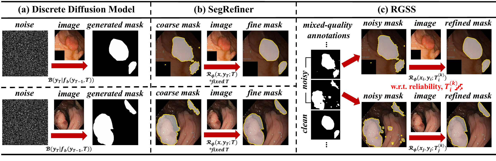
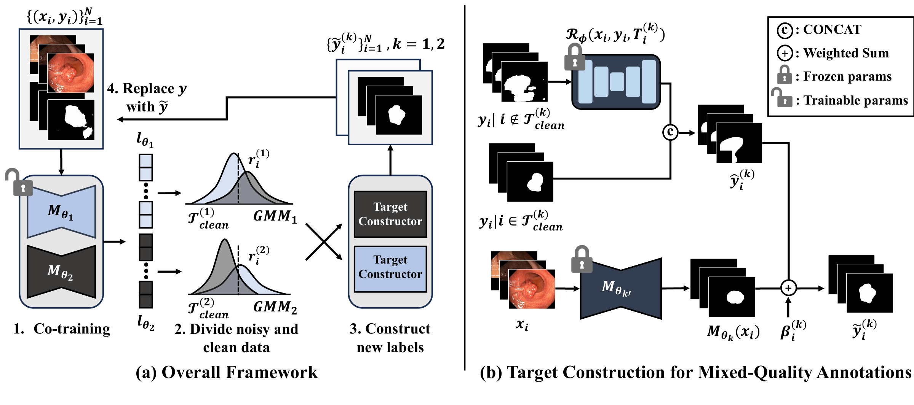

<div align="center">

# RGSS

### Learning Robust Medical Image Segmentation under Mixed-Quality Annotations

Minjae Jeong\* · Seungjoo Lee\* · Jaejin Lee · Won Hwa Kim

Pohang University of Science and Technology (POSTECH)

<sub>\* Equal contribution</sub>

**MICCAI 2026**

<a href="https://papers.miccai.org/miccai-2026/paper/2250_paper.pdf"></a>
<a href="#citation"></a>
<a href="LICENSE"></a>

</div>

---

<p align="center">
  
</p>

---

## TL;DR

**RGSS** (**R**eliability-**G**uided **S**upervision for medical image **S**egmentation) is a model-agnostic training scheme for segmentation datasets whose annotations have mixed quality.

- **Co-estimation of annotation reliability.** Two segmentation networks are co-trained. A Gaussian mixture model fitted to the per-sample losses of one network gives the reliability of each annotation for the other network.
- **Severity-aware refinement.** Annotations judged unreliable are refined by a pretrained discrete-diffusion mask refiner (SegRefiner). The number of reverse steps grows as the reliability drops, so heavily corrupted masks are corrected aggressively and mildly noisy ones keep their details.
- **Peer-guided blending.** Targets are blended with the peer network's prediction, using the reliability for clean samples and an epoch-dependent schedule for refined samples. This limits confirmation bias and errors from the refiner's prior.

## Method

<p align="center">
  
</p>

For the two networks M<sub>θ1</sub>, M<sub>θ2</sub>, after e<sub>0</sub> epochs on the given annotations, every epoch does the following:

1. **Reliability (Eq. 2).** Compute the per-sample Dice losses l<sub>i</sub><sup>(k)</sup> = L(σ(M<sub>θk</sub>(x<sub>i</sub>)), y<sub>i</sub>) and fit a 2-component GMM to them. The reliability of sample i for M<sub>θk</sub> is r<sub>i</sub><sup>(k)</sup> = p(clean | l<sub>i</sub><sup>(k')</sup>), taken from the peer network k' ≠ k.
2. **Refinement (Eq. 3).** Samples with r<sub>i</sub> ≥ τ keep their annotation. Every other sample is refined as ŷ<sub>i</sub> = R<sub>φ</sub>(x<sub>i</sub>, y<sub>i</sub>, T<sub>i</sub>), with T<sub>i</sub> = T<sub>min</sub> + (1 − r<sub>i</sub>)(T<sub>max</sub> − T<sub>min</sub>).
3. **Blending (Eq. 4).** The target is ỹ<sub>i</sub> = β<sub>i</sub> ŷ<sub>i</sub> + (1 − β<sub>i</sub>) M<sub>θk'</sub>(x<sub>i</sub>), where β<sub>i</sub> = r<sub>i</sub> for clean samples and β<sub>i</sub> = α(e) = (e<sub>max</sub> − e)/(e<sub>max</sub> − e<sub>0</sub>) for refined ones.
4. **Training.** Each network is trained with the Dice loss on its targets.

The refiner R<sub>φ</sub> is a discrete diffusion model with a unidirectional fine-to-coarse forward process, following SegRefiner. It is pretrained on the given masks with synthesized coarse masks.

## Code

```
rgss/method.py            per-sample losses, GMM reliability (Eq. 2), target construction (Eqs. 3-4)
rgss/refiner/diffusion.py discrete diffusion refiner R_phi: forward process (Eq. 1), training loss,
                          refinement R_phi(x, y, T) with a sample-dependent number of steps
rgss/corruption.py        structured mask corruption (noisy labels of Sec. 4.1, coarse masks for R_phi)
rgss/segmentation.py      backbones (U-Net, U-Net++, LinkNet, DeepLabV3+), Dice loss, mIoU / mDice
rgss/data.py              datasets
prepare_data.py           Kvasir-SEG / ISIC 2017 conversion
make_noisy_labels.py      mixed-quality annotations (0/25/50% corrupted masks)
train_refiner.py          pre-training of R_phi
train_rgss.py             RGSS training
eval_seg.py               evaluation
```

No hyperparameters are preset. Pass every hyperparameter on the command line ([Hyperparameters](#hyperparameters)).

## Installation

```bash
git clone <this repository> RGSS
cd RGSS
conda create -n rgss python=3.10 -y
conda activate rgss
pip install torch torchvision --index-url https://download.pytorch.org/whl/cu121   # match your CUDA driver
pip install -r requirements.txt
```

## Data preparation

1. **Download** [Kvasir-SEG](https://datasets.simula.no/kvasir-seg/) and [ISIC 2017](https://challenge.isic-archive.com/data/#2017) (Part 1, lesion segmentation), then convert them:
   ```bash
   python prepare_data.py --dataset kvasir --src /path/to/Kvasir-SEG --out data/kvasir
   python prepare_data.py --dataset isic2017 --src /path/to/ISIC-2017 --out data/isic2017   # writes splits/isic2017_*.txt
   ```
   Kvasir-SEG uses the 8:1:1 split in `splits/kvasir_*.txt`. ISIC 2017 uses the official training / validation / test sets.
2. **Mixed-quality annotations (Sec. 4.1).** Corrupt a fraction of the training masks:
   ```bash
   python make_noisy_labels.py --data_root data/kvasir --split splits/kvasir_train.txt --ratio <0.25|0.5> \
       --min_iou <IOU> --max_iters <N> --out_dir masks_noise50
   ```
   - **How a mask is corrupted:** region-wise dilation and erosion with random rectangular, circular or elliptical structuring elements of size 3 or 5, inside random windows, plus stochastic pixel flips. The operations repeat up to `--max_iters` times and stop before the IoU with the original mask falls below `--min_iou`.
   - **Clean setting (0%):** use `--train_mask_dir masks` instead.

## Usage

### 1. Pretrain the refiner R<sub>φ</sub>

```bash
python train_refiner.py --data_root data/kvasir --split splits/kvasir_train.txt --mask_dir masks_noise50 \
    --num_steps <K> --beta_start <B0> --beta_stop <B1> --image_size <S> --model_channels <C> --num_res_blocks <R> \
    --num_heads <H> --attention_strides <A ...> --channel_mult <M ...> --dropout <P> \
    --coarse_min_iou <IOU> --coarse_max_iters <N> --lr <LR> --batch_size <B> --iterations <IT> --texture_weight <W> \
    --out checkpoints/refiner/kvasir_noise50.pth
```

### 2. Train with RGSS

```bash
python train_rgss.py --data_root data/kvasir --split_prefix splits/kvasir --train_mask_dir masks_noise50 \
    --refiner checkpoints/refiner/kvasir_noise50.pth --arch unet --encoder <ENCODER> --image_size <S> \
    --batch_size <B> --lr <LR> --e0 <E0> --e_max <EMAX> --t_min <TMIN> --t_max <TMAX> --tau <TAU> --flip \
    --out_dir runs/kvasir_noise50/unet_rgss
```

- **Backbones:** `--arch` is one of `unet`, `unetplusplus`, `linknet` and `deeplabv3plus`. `--encoder` is any [segmentation_models_pytorch](https://github.com/qubvel-org/segmentation_models.pytorch) encoder, randomly initialized.
- **Plain training:** with `--e0` equal to `--e_max`, the backbone is trained on the given annotations only.
- **Evaluation:** the checkpoint with the best validation mIoU, from either network, is evaluated on the test split. The results go to `results.json`.

### 3. Evaluate

```bash
python eval_seg.py --checkpoint runs/kvasir_noise50/unet_rgss/best.pth --data_root data/kvasir --split splits/kvasir_test.txt
```

mIoU and mDice are the foreground IoU and Dice of every test image (threshold 0.5), averaged over the images.

## Hyperparameters

The values used in the paper are given in Sec. 4.1.

| argument | meaning | paper |
|---|---|---|
| `--ratio`, `--min_iou`, `--max_iters` | annotation noise | Sec. 4.1 |
| `--num_steps`, `--beta_start`, `--beta_stop` | number of diffusion steps K and the fine-state probabilities of R<sub>φ</sub> | Sec. 2, SegRefiner |
| `--image_size`, `--model_channels`, `--num_res_blocks`, `--num_heads`, `--attention_strides`, `--channel_mult`, `--dropout` | denoising UNet of R<sub>φ</sub> | SegRefiner |
| `--coarse_min_iou`, `--coarse_max_iters`, `--lr`, `--batch_size`, `--iterations`, `--texture_weight` | pretraining of R<sub>φ</sub> | SegRefiner |
| `--arch`, `--encoder`, `--image_size`, `--batch_size`, `--lr` | segmentation networks (Adam) | Sec. 4.1 |
| `--e0`, `--e_max` | warm-up epochs e<sub>0</sub>, total epochs e<sub>max</sub> | Sec. 3, 4.1 |
| `--t_min`, `--t_max` | range of the refinement steps T<sub>i</sub> (T<sub>max</sub> ≤ K) | Eq. 3, Sec. 4.1 |
| `--tau` | reliability threshold τ | Sec. 3, 4.1 |

## Acknowledgements

- [SegRefiner](https://github.com/MengyuWang826/SegRefiner) (Wang et al., NeurIPS 2023): the discrete diffusion refiner, its training loss and the mask perturbation.
- [3dOssSeg](https://github.com/Flq2002/3dOssSeg) (MICCAI 2025): a compact SegRefiner implementation that guided our refiner code.
- [DivideMix](https://github.com/LiJunnan1992/DivideMix): co-training with GMM-based sample division.
- [guided-diffusion](https://github.com/openai/guided-diffusion) (MIT): the denoising UNet (`rgss/refiner/guided_diffusion`).
- [segmentation_models.pytorch](https://github.com/qubvel-org/segmentation_models.pytorch): the segmentation backbones.

## Citation

If RGSS is useful in your research, please cite:

```bibtex
@inproceedings{jeong2026rgss,
  title     = {Learning Robust Medical Image Segmentation under Mixed-Quality Annotations},
  author    = {Jeong, Minjae and Lee, Seungjoo and Lee, Jaejin and Kim, Won Hwa},
  booktitle = {Medical Image Computing and Computer Assisted Intervention -- MICCAI 2026},
  series    = {Lecture Notes in Computer Science},
  volume    = {16883},
  year      = {2026}
}
```

## License

Released under the [MIT License](LICENSE). `rgss/refiner/guided_diffusion` is from OpenAI guided-diffusion and keeps its own MIT license.
